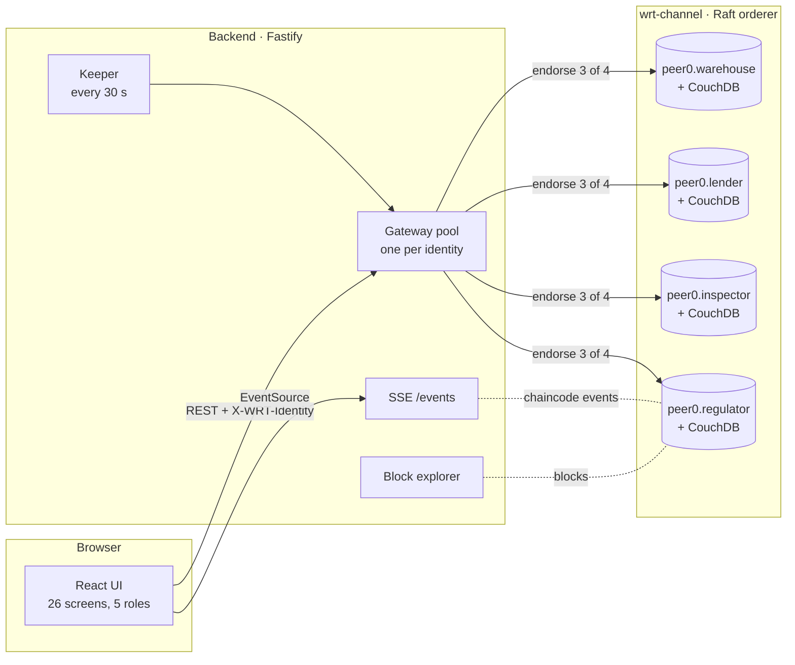

# WRT: warehouse receipts as loan collateral

A farmer stores crop at a licensed warehouse. After an independent inspection, a **warehouse receipt** is minted on a four-organisation Hyperledger Fabric ledger. The farmer pledges it for a loan whose money moves through **escrow released by chaincode rules**: disbursement when on-chain conditions hold, lien release on full repayment, margin calls, default and liquidation. Quality checks and disputes are recorded and enforced on the same ledger.

No single party, not even the warehouse that holds the crop, can change a record alone: every write needs 3 of the 4 organisations to endorse it.

Hackathon proof of concept. Track: Blockchain Development & Engineering.

## Architecture



| Folder | What |
|---|---|
| [`network/`](network/) | Four orgs + orderer, one CA per org, CouchDB, channel, deployment scripts. [Guide](network/README.md) |
| [`chaincode/wrt/`](chaincode/wrt/) | TypeScript chaincode: Registry, Receipt, Loan, Dispute, Query contracts; 152 unit tests |
| [`backend/`](backend/) | REST API over the Fabric Gateway, keeper, SSE events, evidence uploads, block explorer |
| [`frontend/`](frontend/) | React + Vite + Tailwind UI per [`wrt-design/DESIGN_HANDOFF.md`](wrt-design/DESIGN_HANDOFF.md) |
| [`shared/types.ts`](shared/types.ts) | The data contract used by all three |
| [`scripts/`](scripts/) | Seed data and the S1–S7 scenario scripts |
| [`docs/`](docs/) | Trust model, legal equivalence, governance, disputes, benchmark, reviewer responses, decisions |

## Prerequisites

- Linux or WSL2 with **Docker** and Docker Compose v2 (about 4 GB free RAM for 14 containers)
- **Node.js 22**, **pnpm 10** (`corepack enable`), `jq`, `curl`
- **make** (on Fedora: `sudo dnf install make`; on Ubuntu: `sudo apt install make`)
- Internet access on first run (Fabric CLI download, chaincode `npm install` inside the build container)

## Run it

```bash
make up          # CAs, orderer, 4 peers + CouchDB, wrt-channel, chaincode, identities + wallet (~4 min)
make seed-demo   # InitLedger, 4 farmers, and sample receipts/loans for the UI (make seed for the bare minimum)
make dev         # API on :3001, UI on http://localhost:5173
```

Other targets: `make test` (chaincode tests with coverage + typecheck), `make scenarios` (S1–S7), `make deploy` (upgrade chaincode after a change), `make down` (remove everything).

Without `make`, the same steps are:

```bash
pnpm install && pnpm --filter @wrt/shared build
cd network && ./network.sh up && ./network.sh createChannel && ./network.sh deployCC && ./network.sh registerIdentities && cd ..
scripts/with-backend.sh pnpm --filter @wrt/scripts seed:demo
pnpm --parallel --filter @wrt/backend --filter @wrt/frontend dev
```

## Demo accounts

Pick one on the start page. **Demo identity, not real authentication:** each maps to a Fabric wallet identity whose certificate carries `wrt.role` and `wrt.entityId`.

| Identity | Org (MSP) | Role | Entity |
|---|---|---|---|
| Kongwa Grain Store · Mvomero Agro Store | WarehouseMSP | warehouse_operator | WH-001 · WH-002 |
| Neema Mollel · Juma Hassani · Rehema Mushi · Baraka Kimaro | WarehouseMSP (hosted) | farmer | FRM-001 … FRM-004 |
| Dodoma Agri Bank | LenderMSP | lender_officer | LND-BANK-01 |
| Uhuru Rural MFI | LenderMSP (hosted, no peer) | lender_officer | LND-MFI-01 |
| Asha Mrema · Peter Lyimo · Zawadi Ngowi | InspectorMSP | inspector | INS-01 … INS-03 |
| Regulator officer | RegulatorMSP | regulator_officer | REG-01 |

Demo mode is on: grace periods are 3 minutes, the challenge window 10 minutes, the quality-check interval 5 minutes. Toggle it in *Regulator → Prices & policy*.

## Scenarios

Each runs end to end through the API (`make scenarios`, or `pnpm --filter @wrt/scripts s1` … `s7`) and can be clicked through in the UI.

| # | What happens | Click through |
|---|---|---|
| **S1** Happy path | Deposit → attest → issue → WRRB register → offer → accept → fund (auto-disburse) → repay → automatic lien release → withdraw | Warehouse *Record deposit* → Inspector *Inspect* → Regulator *WRRB queue* → Lender *Eligible collateral → Make offer* → Farmer *Loans → Accept* → Lender loan page *Fund escrow* → Farmer *Repay* → Farmer *Request withdrawal* → Warehouse *Withdrawals → Confirm release* |
| **S2** Inflated weight at minting | Declared 10,000 kg, observed 9,200 kg → automatic `MINT_MISMATCH` → re-inspection → `FRAUDULENT` → warehouse suspended | Inspector form shows the red "No receipt" panel → Regulator *Arbitration → Assign* → re-inspector → Regulator *Rule* |
| **S3** Grade challenge after issuance | Lender disputes → receipt frozen, loan clock paused → re-inspection → `CORRECTED` → LTV recomputed → margin call | Lender loan page *Raise dispute* → … → Regulator ruling form |
| **S4** Quality degradation | Quality check finds G3 → margin call → farmer disputes → `STORAGE_NEGLIGENCE` → warehouse compensation into escrow → cured | Lender *Request quality check* → Inspector → Farmer *Raise dispute* → Regulator |
| **S5** Default and liquidation | Maturity + grace pass unpaid → keeper defaults → waterfall pays the lender, surplus to the farmer | Lender loan page after the keeper runs → *Execute liquidation* (waits ~4 min in demo mode) |
| **S6** Tamper attempt | `scripts/demo-tamper.sh` submits a write endorsed only by the Warehouse peer → `ENDORSEMENT_POLICY_FAILURE`; history unchanged | Regulator *Ledger explorer*: rejected attempt with its attempted write, then the receipt's committed history |
| **S7** Hosted MFI onboarding | The MFI's offer fails until the regulator registers it; then it transacts through the Lender peer with no node of its own | Regulator *Entity registry → Lenders*; then the Uhuru Rural MFI identity |

## Design in one paragraph

Access control checks the caller's **MSP and role together** (a role attribute is only as trustworthy as the CA that issued it), then scopes every write to the caller's entity. Every status change goes through one [state machine](chaincode/wrt/src/lib/state-machine.ts). Time comes from the transaction timestamp, randomness from `sha256(txId)`, money is integer TZS and ratios are integer basis points, and state is serialised deterministically, so all endorsing peers produce identical results. Each transaction emits one batched chaincode event, which the backend streams to the UI. Farmer PII lives only in the `farmerPII` private collection, sent as transient data.

## Docs

- [Trust model](docs/TRUST_MODEL.md): the oracle problem and how minting is controlled
- [Legal equivalence](docs/LEGAL_EQUIVALENCE.md): WRT anchors, not replaces, the WRRB receipt
- [Governance](docs/GOVERNANCE.md): hosted members and who can change what
- [Disputes](docs/DISPUTES.md): lifecycle, outcomes, worked examples
- [Benchmark](docs/BENCHMARK.md): versus a centralised registry
- [Reviewer responses](docs/REVIEWER_RESPONSES.md): each review point → feature → doc → scenario
- [Decisions](docs/DECISIONS.md): choices made where the spec was silent
- [Network guide](network/README.md): the Fabric setup explained from zero
