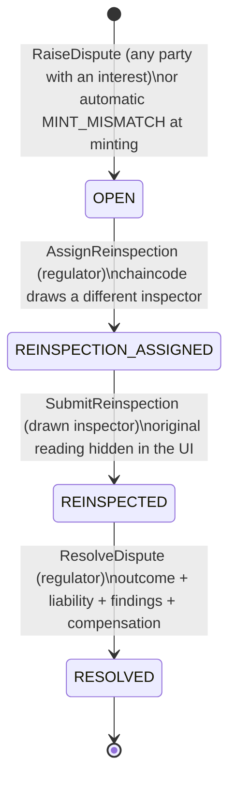

# Disputes

Answers Reviewers 2b and 3. Spec §5.4, §5.6; scenarios S2–S4. Code: [`DisputeContract`](../chaincode/wrt/src/contracts/dispute.ts).

## Lifecycle

While a dispute is open:

- **The receipt is frozen.** `ISSUED`/`PLEDGED` → `UNDER_DISPUTE`; the previous status is saved in `statusBeforeDispute`. It cannot be pledged, withdrawn, quality-checked or disputed again.
- **The loan clock pauses.** `loan.pause = {disputeId, pausedAt}`; the keeper leaves the loan alone. On resolution, the frozen seconds are added to `pausedSecs` (pushing maturity back) and to any margin-call deadline.
- **Evidence rule.** A `MINT_ACCURACY` claim raised after `challengeWindowSecs` must include at least one evidence hash.

Who may raise one: the lender holding the lien, the farmer holding the receipt, the warehouse storing it, any inspector, or the regulator. `MINT_MISMATCH` is only ever opened by the chaincode itself.

## Outcomes and liabilities

| Outcome | Receipt | Loan (if pledged) | Warehouse | Required liability |
|---|---|---|---|---|
| `CONFIRMED` | Unfrozen; values stand | Clock resumes, frozen time added | No change | any |
| `CORRECTED` | Amended to re-inspected values (logged in `amendments`) | LTV recomputed: margin call or default if over threshold | No penalty | any |
| `FRAUDULENT` | `CANCELLED` | Active: `DEFAULTED`; accepted but undisbursed: `CANCELLED` + refund; compensation paid to the lender as a bond claim | `SUSPENDED`, `penaltyCount + 1` | `WAREHOUSE` |
| `NATURAL_DEGRADATION` | Amended to re-inspected values | Normal margin rules: the farmer bears the loss as collateral risk | No change | `FARMER` |
| `STORAGE_NEGLIGENCE` | Amended to re-inspected values | Warehouse compensation credited to the loan through escrow (`COMPENSATION`); may cure a margin call or settle the loan | Liable; compensation recorded against its bond | `WAREHOUSE` |

For a **`MINT_MISMATCH`** dispute (subject is a deposit, no receipt exists yet):

| Outcome | Effect |
|---|---|
| `CONFIRMED` | Mint the receipt with the **warehouse's declared** values (the declaration was right) |
| `CORRECTED` | Mint with the **re-inspected** values |
| `FRAUDULENT` | Deposit `REJECTED`; warehouse suspended and penalised |

The re-inspector is drawn from ACTIVE inspectors, excluding inspectors with a declared conflict with the warehouse, the inspector whose reading is disputed, and the latest quality-check inspector.

## Worked examples

These match the scenario scripts in [`scripts/scenarios/`](../scripts/scenarios/), which run end to end against the network.

### S2: inflated weight at minting (Reviewer 3)

1. WH-002 records a deposit: maize G1, **declared 10,000 kg**.
2. The chaincode draws INS-01 (INS-02 is conflicted with WH-002). INS-01 weighs **9,200 kg**: a −8.00% gap against a ±0.50% tolerance.
3. **No receipt is minted.** The deposit goes to `MISMATCH_DISPUTED`; `DSP-0001` (`MINT_MISMATCH`) opens automatically.
4. The regulator tries to rule straight away and is refused: `ILLEGAL_TRANSITION: dispute OPEN -> RESOLVED`.
5. The regulator triggers the draw: INS-03 (excluding INS-01, the original, and INS-02, conflicted) re-weighs 9,180 kg.
6. Ruling **`FRAUDULENT`, liability `WAREHOUSE`**: deposit `REJECTED`, WH-002 `SUSPENDED`, penalty count 1. Its next deposit fails with `NOT_AUTHORISED: warehouse WH-002 is SUSPENDED`.

### S3: post-issuance grade challenge (Reviewer 3)

1. A maize G1 receipt (12,400 kg × 850 = 10,540,000 TZS collateral) secures a 6,000,000 TZS loan (6,540,000 due).
2. The lender raises `MINT_ACCURACY` with a lab-report hash. The receipt freezes; the loan clock pauses.
3. The re-inspector finds **G3**. Ruling **`CORRECTED`**: grade amended G1 → G3 (logged), receipt back to `PLEDGED`.
4. At the G3 price (680/kg) collateral is 8,432,000, so LTV is 77.6% ≥ 75%: **margin call**, pay down 216,001 TZS within the grace period. The frozen seconds are added to maturity.

### S4: quality degradation during a loan (Reviewer 2)

1. Same loan. The lender requests a quality check; the drawn inspector finds G3 and high moisture. The receipt is amended and the loan goes to **`MARGIN_CALL`**.
2. The farmer disputes (`QUALITY_DEGRADATION`): the store's roof leaked.
3. A different inspector (the QC inspector is excluded) confirms the damage.
4. Ruling **`STORAGE_NEGLIGENCE`, liability `WAREHOUSE`, compensation 1,000,000 TZS**: a `COMPENSATION` entry is written to the escrow and credited to the loan. Outstanding drops to 5,540,000, LTV to 65.7%: **margin call cured**, loan back to `ACTIVE`.

Had the ruling been `NATURAL_DEGRADATION`, the farmer would bear the loss and the margin call would stand.
